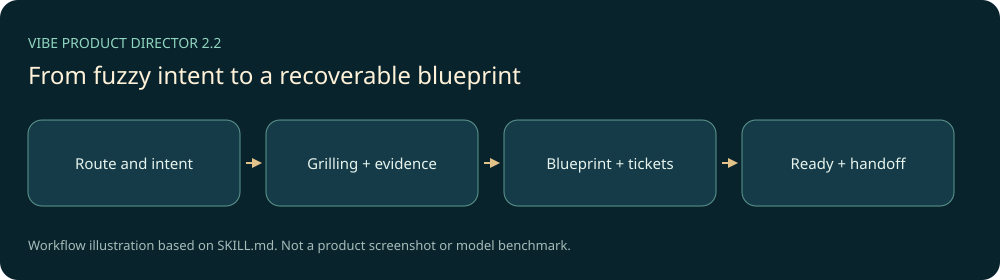

# Vibe Product Director

把模糊的网站、应用、小程序或重大改版想法，持续梳理为可交接的产品、体验、系统、开发任务和验收蓝图。当前保全版本为**2.2.0**：多轮访谈保留决策树、证据与恢复状态，避免问完一轮就过早收尾。



## 能力与边界

- 区分新项目、已有产品、恢复与蓝图变更，按影响选择当前问题。
- 保存设计树、待解决分支、证据和已授权默认值，保持多轮连续性。
- 产品价值、视觉体验、前后端动作与失败恢复相互追踪。
- 六份核心蓝图按需扩展；经质疑、简化和独立交接检查后形成开发任务。

它是AI宿主的规划技能，默认终点是蓝图Ready。普通局部改色、明确Bug和已批准任务不适用。实际开发、对外取证或证据原型仍受当前用户授权约束。不是一个自动开发或发布网站的独立程序。

## 安装与使用

准备支持`SKILL.md`的宿主。PowerShell进入仓库：

```powershell
./skill/vibe-product-director/scripts/install.ps1 -TargetRoot "$env:USERPROFILE/.codex/skills" -DryRun
./skill/vibe-product-director/scripts/install.ps1 -TargetRoot "$env:USERPROFILE/.codex/skills"
```

安装器默认拒绝替换不同版本，明确使用`-Force`时先做时间戳备份。先阅读输出，保留自己的本地修改；不要把个人项目蓝图或账号资料放进技能源码。macOS/Linux入口为同目录`install.sh`，本次只实际验收Windows安装。

刷新宿主技能发现后，例如：

```text
使用 $vibe-product-director 规划一个给大学社团用的活动报名网站。先读取已有资料，梳理用户、流程、视觉和验收蓝图，我还没有授权开始实现。
```

## 技术、结构与复现

核心为Markdown、YAML和模板，无模型/API运行时。打包与结构校验使用Python3.10+标准库；安装使用PowerShell或Bash。PyYAML可选用于完整YAML解析。

```text
skill/vibe-product-director/  2.2.0完整入口、参考、模板、评测数据和工具
variants/v2.0.0/             已安装旧版完整源快照
variants/v2.1.0/             中间版完整源快照
docs/development/            原开发审计与历史评测记录
licenses/                    上游来源许可
```

在2.2.0目录运行：

```powershell
python scripts/validate_release.py
python scripts/build_release.py --output-dir <新建输出目录>
```

本次实际验证三个版本的结构、链接、评测格式和文件清单；执行2.2打包并校验ZIP每字节，以及安装到迁移任务内的新目录后逐文件读回。详细范围见[VALIDATION.md](VALIDATION.md)。没有把评测场景数量当成新的模型行为通过数，也没有实际运行多轮产品访谈。

## 来源、许可与后续

这是AI辅助开发的本机定制项目，2.2参考了Matt Pocock方法体系的中文整理，保留[来源与原MIT](THIRD_PARTY_NOTICES.md)。[PROVENANCE.md](PROVENANCE.md)说明版本选择。自有部分采用[MIT](LICENSE)。

继续通过真实访谈校正分支覆盖、问题负担和蓝图交接；版本变更写入[CHANGELOG.md](CHANGELOG.md)。原本地项目和不同安装版保留，本批不自动替换全局技能。
